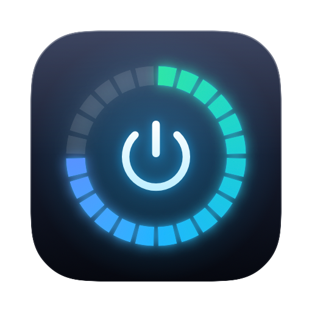
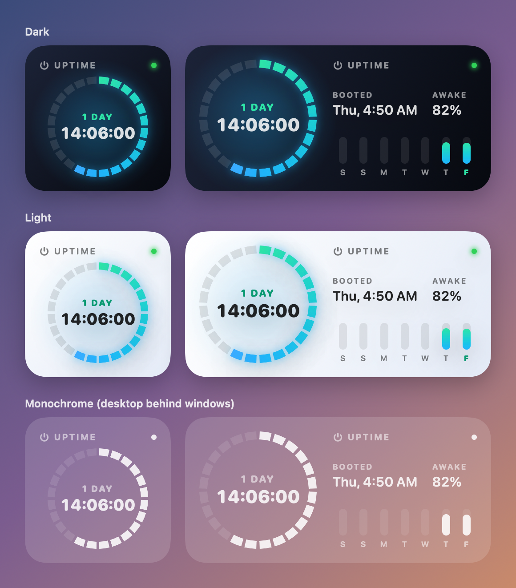

# uptime_macos_widgets



A macOS desktop widget that shows how long your Mac has been up — the same
"Time since boot" figure System Information reports, live on your desktop.



- **24-hour dial** — one segment per hour of the current day of uptime; it fills
  and starts over each day while the day count goes up.
- **Live clock** — ticks every second, always as H:MM:SS.
- **Medium size** adds when the Mac booted, how much of that time it was awake
  rather than asleep, and how much of each of the last seven days it was up.
- Follows light and dark mode, and stays legible when macOS draws desktop
  widgets in monochrome behind windows.

## Requirements

- macOS 15 or later (built and tested on macOS 27)
- Xcode, for the macOS SDK and `swiftc` — no Xcode project is used
- An **Apple Development** signing certificate (a free Apple ID works). macOS
  registers widgets signed ad-hoc but may leave them out of the widget gallery.

## Build and install

```bash
./build.sh install
```

This builds `Uptime.app`, copies it to `/Applications`, registers it and opens
it once. Then right-click the desktop → **Edit Widgets…** → search **Uptime**.

`build.sh` signs with the first Apple Development identity in your keychain.
Set `IDENTITY` to use another one, or `IDENTITY=-` for ad-hoc signing.

To uninstall, delete `/Applications/Uptime.app`.

## Notes

- **Uptime source** — `kern.boottime`, which counts time asleep, so it matches
  System Information. "Awake" uses `ProcessInfo.systemUptime`, which doesn't.
- **Refreshing** — the clock ticks on its own; the timeline re-renders the dial
  every 5 minutes and reloads every 30 minutes, so after a reboot the widget can
  show the old uptime briefly until macOS reloads it.
- **No Xcode project** — the extension is linked with `-e _NSExtensionMain`, as
  Xcode does. Without it the extension starts at the Swift `main`, skips
  extension setup, and traps on launch, so it never reaches the gallery.
- **Certificate shows as invalid?** If `security find-identity -v -p codesigning`
  doesn't list your Apple Development certificate, your keychain is probably
  missing Apple's [WWDR G3 intermediate](https://www.apple.com/certificateauthority/AppleWWDRCAG3.cer).
  Add it with
  `security add-certificates -k ~/Library/Keychains/login.keychain-db AppleWWDRCAG3.cer`.

## Layout

| Path | What it is |
| --- | --- |
| `Sources/Shared/` | Boot time, snapshot model and the widget's SwiftUI view |
| `Sources/Widget/` | WidgetKit extension: timeline provider and widget |
| `Sources/App/` | Host app; shows a live preview of both sizes |
| `Resources/` | Info.plists, the sandbox entitlement and `AppIcon.icns` |
| `Icon/` | Draws the app icon (`./build.sh icon` regenerates `AppIcon.icns`) |
| `Preview/` | Renders `docs/preview.png` from placeholder data (`./build.sh preview`) |
